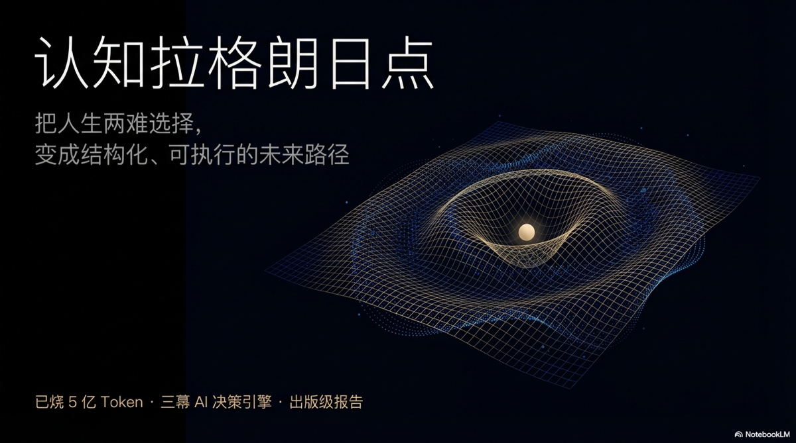
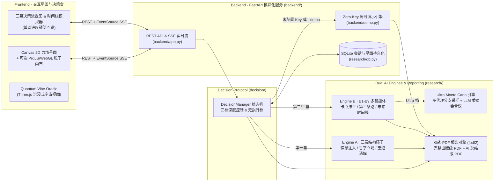

<div align="center">

# 认知拉格朗日点 · Cognitive Lagrange Point

**把人生与商业的高代价两难选择，推演为可验证、可止损、可执行的未来路径**  
*Dual-Engine Multi-Agent Decision Breakthrough & Future Timeline Simulator*

[](requirements.txt)
[](backend/app.py)
[](package.json)
[](#1-零配置即刻体验无需-api-key)
[](LICENSE)

[架构设计文档](docs/ARCHITECTURE.md) · [展示文稿 PDF](docs/showcase/Cognitive_Lagrange_Point.pdf) · [报告样例 PDF](docs/showcase/decision_sample_report.pdf)

</div>

---



## 为什么需要「认知拉格朗日点」？

大多数 AI 问答面对人生或商业两难问题（*“该留在稳定大厂还是辞职做 AI 产品？”、“要不要去异地读研？”、“是否应该切入新赛道？”*）时，只会给出一套四平八稳的“利弊清单”。但你真正卡住的原因从来不是不知道利弊，而是：

1. **分不清问题的本质**：它究竟是底层价值公理正面锁死的**“真认知拉格朗日点（结构性无解）”**，还是仅仅因为缺关键事实、缺判断框架而导致的**“伪 50:50 僵局”**？
2. **看不见动态后果**：选 A 或选 B 在第 1 周、第 3 个月、1 年后分别会发生什么？顺风局怎么扩果、逆风局怎么止损？有没有不必非黑即白的**“第三条路”**？

**Cognitive Lagrange Point** 用一套严谨的**三幕式双引擎架构**解决这一问题：
- **第一幕（Engine A · 结构筛子）**：通过多量级信息注入、多哲学立场力矩对抗、跨语境重述消解三道筛子，精准识别问题属于“公理级拉格朗日平衡”还是“可突破的现实决策”。
- **第二幕（Engine B · 认知突破）**：针对可突破问题，启动 `B1–B5` 多智能体诊断信息黑洞、切换决策框架、模拟过来人案例、识别损失厌恶等心理偏差，并自动发掘低成本可逆的**第三条路（B5.5）**与重算建议（`C1`）。
- **第三幕（Choice Simulator · 未来选择模拟器）**：采集安全垫与可逆边界（`B6`），并行推演 A/B 双路径的**顺风 / 平稳 / 逆风**三条时间线（`B7`）、红黄绿信号灯岔路口与最坏情况生存卡（`B8`）、后悔分数与行动地图（`B9`），并在 `Ultra` 档追加 **Monte Carlo 多代理分支碰撞**。
- **双轨出版级交付**：一键导出带星图封面、雷达图与故事板时间线的**完整版 PDF**，以及供快速复盘/汇报的 **AI 一页总结版 PDF**。

---

## 系统架构 (System Architecture)



---

## 四档思考深度矩阵 (4-Tier Depth Matrix)

系统内置四档思考深度，支持在推演完成后通过 `/api/decision/upgrade` 原地向高档位无损升级：

| 档位 | 标识 | 预估耗时 | 预估预算上限 | 第一幕 (Engine A) | 第二幕 (Engine B) | 第三幕 (未来模拟器) | 适用场景 |
| :--- | :--- | :---: | :---: | :--- | :--- | :--- | :--- |
| **`quick`** | ⚡ 快速 | ~5s | ~4K tokens | 极速结构预判 | — | — | 日常小纠结，5 秒拿到直觉突破口与首步动作 |
| **`deep`** *(默认)* | 💡 沉思 | ~30s | ~42K tokens | 筛子 1 + 筛子 2 (4 框架) | B1 追问 + B2 信息 + B3 框架 + B5.5 第三条路 + C1 重评 | 支持手动按需开启 | 绝大多数职场、消费与个人路径选择 |
| **`pro`** | 🔥 Pro | ~3-5m | ~320K tokens | 完整三层筛子 + 力场解剖 | 全量开启（含 B4 经验案例 + B5 情绪镜像 + 二次复核） | 自动开启 A/B 三态时间线 + 岔路口 + 生存卡 | 换工作、迁居、创业等高转换成本重大决策 |
| **`ultra`** | 🌌 Ultra | ~5-15m | 10M+ 口径可调 | 全量 7 哲学立场 + 深度重述 | 超长上下文全量拆解 + 外部声音快照融合 | 全量模拟 + **Monte Carlo 多代理碰撞 & LLM 委员会** | 极高复杂度战略推演、团队合议与出版级归档 |

---

## 快速启动 (Quick Start)

### 环境准备

支持 **Windows / macOS / Linux**（推荐 Python 3.11+，Node.js 18+ 仅在前端开发或重构建时需要）：

```bash
pip install -r requirements.txt
```

### 1. 零配置即刻体验（无需 API Key）

克隆仓库后**无需配置任何密钥**，直接启动即可自动进入 **Offline Demo Mode**（或显式添加 `--demo` 参数），完整体验拉格朗日点力场解剖、Engine B 三幕推演、Monte Carlo 碰撞及双版本 PDF 报告导出：

```bash
# 跨平台一键启动并自动打开浏览器（Windows / macOS / Linux 通用）
python start.py --demo --open

# 或直接运行根入口
python server.py --host 127.0.0.1 --port 4173 --demo
```

启动后访问：
- 主控制台：[http://127.0.0.1:4173](http://127.0.0.1:4173)
- WebGL 增强星图模式：[http://127.0.0.1:4173/?webgl=1](http://127.0.0.1:4173/?webgl=1)

### 2. 配置真实大模型（Live LLM Mode）

复制环境变量模板并填入任意 **OpenAI 兼容接口**（如 OpenAI、Claude Proxy、DeepSeek、OpenRouter 等）：

```bash
cp .env.clp.example .env.clp   # PowerShell: Copy-Item .env.clp.example .env.clp
```

编辑 `.env.clp`：

```ini
CLP_API_KEY=sk-your-real-api-key
CLP_BASE_URL=https://your-openai-compatible-proxy.example/v1
CLP_MODEL=claude-sonnet-4-6
CLP_MODEL_FALLBACKS=deepseek-v3
CLP_DEMO_MODE=0
```

然后启动服务：

```bash
python server.py
```

> **安全说明**：`.env.clp` 已纳入 `.gitignore` 严格排除，且 `/api/config` 与 `/api/system/info` 接口均对密钥做脱敏掩码处理，绝不向外暴露明文 API Key。

### 3. 前端 Vite 热更新开发模式

```bash
npm install
npm run dev      # 默认监听 http://127.0.0.1:4174 并代理后端 API
npm run build    # 构建生产静态资源至 dist/
```

---

## 目录结构 (Repository Layout)

```text
Cognitive-Lagrange-Point/
├── server.py                      # 根级兼容入口与 CLI（导出 app / DECISIONS / DETECTION / RUNTIME）
├── start.py                       # 跨平台一键启动脚本（支持 --host / --port / --demo / --open）
├── backend/                       # 模块化 FastAPI 后端包
│   ├── app.py                     # FastAPI 应用、REST/SSE 路由、/api/health 与 /api/system/info
│   ├── core.py                    # Engine A / Engine B 运行时统一门面
│   ├── detection.py               # 单题结构检测异步任务管理器
│   ├── runtime.py                 # 批量科研挖掘子进程与实验历史管理器
│   ├── demo.py                    # 零依赖离线演示推演引擎（支持全档位与双 PDF 导出）
│   └── shared.py                  # 路径常量、环境变量解析、密钥脱敏与演示状态判定
├── decision/                      # 产品级三幕决策协议
│   ├── pipeline.py                # DecisionManager 状态机、SSE 同步、升档与模拟编排
│   ├── tiers.py                   # Quick / Deep / Pro / Ultra 四档预算与能力矩阵
│   ├── classifier.py              # 快速档结构分类与直觉建议构造器
│   └── reporting.py               # 完整版 PDF 与 AI 总结版 PDF 上下文聚合
├── research/                      # 双引擎核心算法与报告渲染
│   ├── api.py                     # OpenAI 兼容客户端、SSE/JSON 抢救解析与三级模型降级
│   ├── single_detect.py           # 单题三层筛子检测管线
│   ├── phase1_mining.py           # 阶段一：六大交界面候选挖掘
│   ├── phase2_filter*.py          # 阶段二：筛子1(信息注入)、筛子2(多立场)、筛子3(重述消解)
│   ├── phase3_*.py / phase4_*.py  # 阶段三/四：力量解剖、稳定性、认知振荡与断层线预测
│   ├── engine_b/                  # Engine B 多智能体（B1-B9、第三条路、外部声音、Monte Carlo）
│   ├── output_formatter.py        # 跨平台 fpdf2 矢量报告与可选 WeasyPrint HTML 渲染器
│   └── db.py                      # SQLite 会话与拉格朗日星图持久化层
├── frontend/                      # 原生 ESM 模块化前端
│   ├── core/                      # 全局状态、Canvas/WebGL 渲染器、命中交互系统
│   ├── components/                # 三幕决策视图、时间线卡片、档位选择器、QuantumUniverseView
│   └── modules/                   # 决策协议客户端、Engine A/B 状态桥接、Quantum Vibe Oracle
├── docs/
│   ├── ARCHITECTURE.md            # 系统架构与核心协议详解
│   ├── showcase/                  # 展示文稿 PDF、报告样例 PDF 与高清预览图
│   └── archive/                   # 历史迭代设计手记归档
├── data/external_signals/         # 本地外部市场声音基准快照
└── tests/                         # Python 单元/API 测试套件与 Node/Playwright 回归探针
```

---

## REST & SSE 接口速览 (API Reference)

| 方法与路径 | 说明 |
| :--- | :--- |
| `GET /api/health` | 健康检查：返回双引擎、SQLite、PDF 渲染器就绪状态及离线演示可用性 |
| `GET /api/system/info` | 系统元信息：返回四档配置摘要、脱敏模型状态（绝不暴露明文 Key）及前端挂载模式 |
| `GET /api/decision/tiers` | 获取 `quick` / `deep` / `pro` / `ultra` 完整配置与 Token 预算拆解 |
| `POST /api/decision/start` | 启动决策流程，支持 `{"question": "...", "tier": "deep", "demo": true}` |
| `GET /api/decision/status?id=...` | 查询指定决策会话的最新快照 |
| `GET /api/decision/events?id=...` | **SSE 实时流**：推送阶段演进与星图粒子事件（`star_event`） |
| `POST /api/decision/answer` | 提交第二幕（`B1`）卡点追问或第三幕（`B6`）模拟参数回答 |
| `POST /api/decision/simulate/start` | 为已完成第二幕的会话手动开启第三幕未来选择模拟器 |
| `POST /api/decision/upgrade` | 将已有决策会话原地升级至更高思考档位（复用已有检测快照） |
| `POST /api/decision/feedback` | 记录用户的最终真实选择与事后满意度反馈 |
| `GET /api/decision/report?id=...` | 动态生成并下载**完整出版级 PDF 报告** |
| `GET /api/decision/summary-report?id=...` | 动态生成并下载 **AI 一页总结版 PDF 报告** |

---

## 测试与质量验证 (Testing & Verification)

```bash
# 1. 运行全量 Python 单元与 API 集成测试（含离线演示与双 PDF 生成校验）
pytest -v

# 2. 运行 Ruff 静态代码质量检查
ruff check server.py start.py backend decision research tests

# 3. 运行前端与测试脚本静态语法及纯逻辑校验
node tests/thinking_log_dedupe.mjs
node tests/quantum_oracle_static.mjs
python tests/pipeline_recheck_guard.py

# 4. 完整构建与浏览器端到端回归（需安装 npm 依赖与 Playwright 浏览器）
npm run verify:all
```

---

## 开源协议 (License)

本项目基于 [MIT License](LICENSE) 开源，Copyright (c) 2026 Johnson Du。
